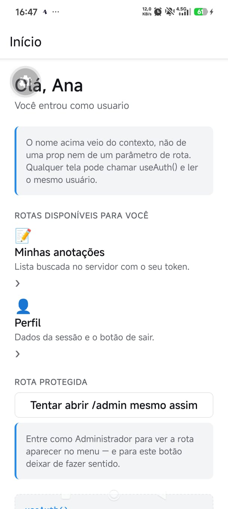
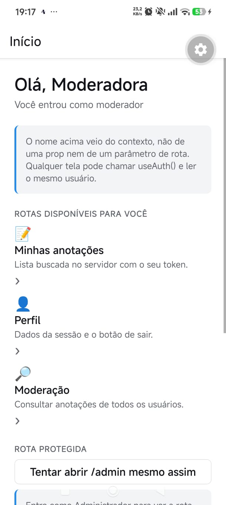
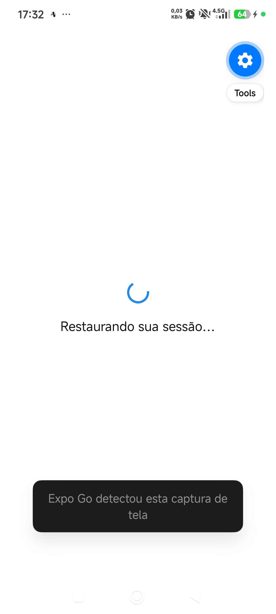
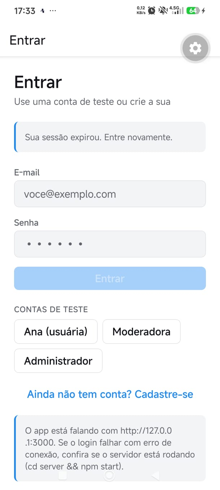

# Trabalho Prático II — Autenticação, Contexto e Rotas Protegidas

**Aluna:** Julie Monteiro  
**Disciplina:** Desenvolvimento de Aplicativos

## Como executar

Requisitos: Node.js e npm instalados. Abra dois terminais na pasta `Trabalho_2`.

**Terminal 1 — API:**
```bash
cd server
npm install
npm start
```

**Terminal 2 — Expo:**
```bash
npm install
npx expo start
```

O servidor escuta na porta 3000 e mantém os dados em memória.

### Rodando no celular

**No simulador de iPhone (Mac com Xcode):**

1. No Mac, tenha o **Xcode** instalado com um simulador de iOS (Xcode → Settings → Components/Platforms → iOS).
2. Terminal 1, na pasta `Trabalho_2`: `cd server && npm install && npm start`.
3. Terminal 2, na pasta `Trabalho_2`:

```bash
npm install
npx expo start --ios
```

(Ou rode `npx expo start` e aperte `i` no terminal.) O Expo abre o simulador e instala o Expo Go nele automaticamente na primeira vez.

No simulador, `localhost` e o IP do Mac apontam para o próprio Mac, então o app encontra a API sozinho, sem nenhuma configuração extra — o endereço usado aparece no aviso do rodapé da tela de login. Se o macOS perguntar se o Node pode aceitar conexões de rede, clique em **Permitir**.


**Pelo cabo USB (Android) — forma recomendada e testada:**

1. No celular, ative as Opções do desenvolvedor e a **Depuração USB**, conecte o cabo e aceite a mensagem "Permitir depuração USB".
2. Confira se o computador enxerga o aparelho: `adb devices` deve listar o celular com a palavra `device` (no Ubuntu, instale com `sudo apt install adb` se necessário).
3. Com o servidor rodando no Terminal 1, rode no Terminal 2, na pasta `Trabalho_2`:

```bash
adb reverse tcp:8081 tcp:8081
adb reverse tcp:3000 tcp:3000
npx expo start --localhost --android
```

O `adb reverse` cria um túnel pelo cabo: no celular, `127.0.0.1:8081` passa a ser o Expo do computador e `127.0.0.1:3000` passa a ser a API. O `--localhost` faz o Expo Go abrir `exp://127.0.0.1:8081` em vez do IP do Wi-Fi, então firewall e rede não interferem. O mesmo pode ser feito com `npm run celular-usb`.

Se o cabo for desconectado ou o celular reiniciar, rode os dois `adb reverse` de novo. Na primeira execução o bundle pode demorar alguns minutos.

**No iPhone (Expo Go, pelo Wi-Fi):** o iPhone não tem `adb reverse`, então a conexão é sempre pela rede.

1. Instale o **Expo Go** pela App Store, numa versão compatível com o Expo SDK 57 (mantenha o app atualizado).
2. Conecte o iPhone e o computador **na mesma rede Wi-Fi**.
3. Libere as portas no firewall do computador (no Ubuntu: `sudo ufw allow 8081` e `sudo ufw allow 3000`).
4. Com o servidor rodando no Terminal 1, rode no Terminal 2, na pasta `Trabalho_2`:

```bash
npx expo start
```

5. Abra o app **Câmera** do iPhone e aponte para o QR code do terminal; toque no aviso para abrir no Expo Go.
6. Na primeira vez, o iOS pergunta se o Expo Go pode **encontrar dispositivos na rede local**: toque em **Permitir**. Sem essa permissão o app não alcança o computador. (Se negou sem querer: Ajustes → Expo Go → Rede Local.)

O app descobre sozinho o IP do computador pelo Expo e usa `http://IP_DO_COMPUTADOR:3000` para a API; o endereço aparece no aviso do rodapé da tela de login.

Para conferir a rede antes, abra `http://IP_DO_COMPUTADOR:3000` no **Safari** do iPhone: deve aparecer o JSON do servidor. Se não abrir, o firewall ou a rede está bloqueando. Redes de faculdade costumam isolar os aparelhos; nesse caso, ative o **Acesso Pessoal** (hotspot) do iPhone, conecte o computador nele e rode `npx expo start` de novo.

Se a mensagem de erro mostrar o endereço errado (por exemplo `127.0.0.1`), informe o IP manualmente (descubra com `hostname -I` no Linux ou `ipconfig` no Windows):

```bash
EXPO_PUBLIC_API_URL=http://IP_DO_COMPUTADOR:3000 npx expo start
```

**Android pelo Wi-Fi:** os mesmos passos do iPhone valem para Android, escaneando o QR code de dentro do próprio Expo Go.

Se o servidor não responder em 8 segundos, o app mostra o erro de conexão em vez de ficar carregando indefinidamente.

### Contas de teste

| E-mail | Senha | Papel |
|---|---|---|
| `ana@ifrs.edu.br` | `123456` | usuario |
| `moderador@ifrs.edu.br` | `mod123` | moderador |
| `admin@ifrs.edu.br` | `admin123` | admin |

Reiniciar o servidor apaga usuários cadastrados durante o uso, anotações e tokens; as contas de teste e as anotações iniciais da Ana são recriadas.

## Requisitos implementados

### 4.1 — Sessão expirada (401)
O tratamento foi centralizado em `src/services/api.ts`: a função comum de requisição chama o callback registrado quando uma requisição com token recebe 401. O `AuthProvider`, em `src/contexts/auth-context.tsx`, limpa a sessão, apaga o AsyncStorage e marca `sessaoExpirada`; o layout raiz troca para o grupo de autenticação porque o estado mudou, sem `router.replace()`. Um 403 não aciona o callback e permanece como erro de permissão. A tela `src/app/(auth)/login.tsx` mostra “Sua sessão expirou. Entre novamente.” O logout voluntário limpa esse aviso.

### 4.2 — Estado carregando
`carregando` pertence ao `AuthContext` e fica verdadeiro durante login/cadastro. `src/components/tela-de-espera.tsx` fornece o indicador e a mensagem, usados nas telas de autenticação. A tela de login mantém seus estados locais enquanto apenas troca condicionalmente o conteúdo renderizado pela espera; assim, quando a requisição falha, o componente continua montado e a mensagem de erro permanece. O erro é tratado com `instanceof ApiError`.

### 4.3 — Detalhe de anotação
A antiga `src/app/(app)/anotacoes.tsx` foi reorganizada em `src/app/(app)/anotacoes/index.tsx`, e `src/app/(app)/anotacoes/[id].tsx` implementa o detalhe. `src/components/anotacao-item.tsx` permite tocar no item; o identificador é passado como parâmetro e a tela busca os dados novamente por `api.buscarAnotacao`, em `src/services/api.ts`. O servidor implementa `GET /anotacoes/:id` em `server/index.js`, usando `banco.buscarAnotacao` em `server/banco.js`, que responde 404 tanto para item inexistente quanto para item de outra pessoa. O detalhe mostra espera, erro (incluindo 404) ou texto/data formatada.

A rota fica dentro de `(app)` porque o grupo representa as telas que só existem com uma sessão autenticada. Assim, o `Stack.Protected` do layout raiz protege também o detalhe. Se estivesse fora do grupo, não herdaria a proteção interna do grupo logado e seria necessário configurar uma proteção própria; a tela poderia ficar acessível na árvore de navegação para quem não está autenticado, embora o servidor ainda devesse rejeitar a requisição sem token.

### 4.4 — Papel moderador
O tipo `Papel` em `src/models/usuario.ts` inclui `moderador`. `server/banco.js` cria a conta de teste e reúne as anotações com o nome do autor; `server/index.js` usa o middleware reutilizável `somentePapeis` para proteger `GET /moderacao/anotacoes` para moderador/admin. A tela `src/app/(app)/moderacao.tsx` lista as anotações e autores. `src/app/(app)/_layout.tsx` protege a rota para moderador e admin, mantendo `/admin` exclusivo do admin. `src/app/(app)/index.tsx` mostra o link de moderação apenas para esses papéis e `src/app/(auth)/login.tsx` inclui atalho para preencher a conta de moderadora.

Arquivos alterados para acrescentar/usar o papel:
- `server/banco.js`: cria a conta moderadora e expõe as anotações de todos com autor.
- `server/index.js`: lista a conta/rota e exige `moderador` ou `admin` no middleware.
- `src/models/usuario.ts`: acrescenta `moderador` ao tipo `Papel` e o autor opcional no tipo de anotação.
- `src/app/(app)/_layout.tsx`: restringe a tela de moderação aos papéis permitidos.
- `src/app/(app)/index.tsx`: exibe o link conforme o papel.
- `src/app/(app)/moderacao.tsx`: apresenta a lista de moderação.
- `src/app/(auth)/login.tsx`: oferece o atalho para preencher a conta de moderadora.
- `src/services/api.ts`: adiciona a chamada autenticada à rota de moderação.

### 4.5 — Sessão persistente
`src/services/api.ts` usa `@react-native-async-storage/async-storage` para ler, salvar e apagar a sessão. Login/cadastro salvam a sessão; logout e 401 apagam. Ao abrir o app, `AuthProvider` lê a sessão e chama `GET /auth/me`. O estado `restaurando` mantém uma tela de espera no layout raiz até terminar a validação, impedindo que o login apareça brevemente antes da decisão.

Se o servidor estiver fora do ar durante a abertura, a requisição falha com `ApiError` de status `0`. O app não assume que o token é válido e mostra o login, mas preserva o token salvo para permitir uma nova tentativa em uma próxima abertura. Somente um 401 confirma que a sessão deixou de ser válida e remove o token.

### 4.6 — Funções recriadas a cada render
Quando o `value` de um contexto muda por identidade, React re-renderiza os componentes consumidores que usam aquele contexto, mesmo que alguns campos tenham o mesmo conteúdo. Neste projeto, o `AuthProvider` recria `entrar`, `cadastrar`, `sair` e o objeto `value` a cada renderização. O `app.json` tem `experiments.reactCompiler: true`, portanto o React Compiler pode otimizar funções e valores automaticamente; isso não significa que toda renderização adicional desapareça em qualquer cenário e deve ser observado, não presumido.

Sem o React Compiler, envolveria as funções em `useCallback` com suas dependências e montaria o objeto do contexto com `useMemo`, também com dependências corretas. Como evidência inicial, `src/components/sessao-atual.tsx` registra no console `[evidência Context API] SessaoAtual renderizou` com a rota e o papel atual. Faça login e observe o terminal; depois desative `reactCompiler` em `app.json`, reinicie o Expo limpando o cache (`npx expo start -c`) e compare. O log indica renderizações, mas não prova sozinho que elas causam lentidão; o Profiler seria a medida mais completa.

**Resultado observado.** Com o log em `SessaoAtual`, executei o fluxo Perfil → Sair → Entrar com `reactCompiler` ligado e desligado:

| Ação | `reactCompiler: true` | `reactCompiler: false` |
|---|---|---|
| Abrir Perfil (`/perfil`) | 2 | 2 |
| Sair → tela de login (`/login`) | 2 | 2 |
| Entrar → Início (`/`) | 1 | 1 |

O número de renderizações foi o mesmo nas duas configurações. As renderizações acompanharam mudanças reais do contexto (usuário entrou ou saiu) e da rota, e não a recriação de `entrar`, `cadastrar` e `sair`. Concluo que, neste app pequeno, a recriação das funções não gera custo perceptível. Em um contexto com muitos consumidores, `useCallback` e `useMemo` (ou o React Compiler) evitariam renderizações desnecessárias. Após o teste, `reactCompiler` voltou a `true`.

## Roteiro de testes

Todos os testes abaixo foram executados com o app em um celular Android. Deixe o terminal do servidor visível: cada requisição aparece nele (por exemplo `GET /auth/me -> 200`).

### 0. Preparação
- Terminal 1: `cd server && npm start`.
- Terminal 2: inicie o app por uma das formas da seção "Rodando no celular".
- **Esperado:** abre a tela de login; o aviso no rodapé mostra o endereço da API em uso.

### 4.2 — Estado carregando
| Passo | Esperado |
|---|---|
| Tocar em **Ana (usuária)** e em **Entrar** | Aparece "Entrando na sua conta…" e depois o Início com "Olá, Ana" |
| Sair, digitar a senha `999999` e tocar em Entrar | A espera aparece e o login volta com "E-mail ou senha incorretos." — o e-mail digitado continua no campo (o erro não se perde) |

### 4.3 — Detalhe da anotação
| Passo | Esperado |
|---|---|
| Como Ana, abrir **Minhas anotações** e tocar em uma anotação | "Carregando anotação…" e depois o texto, a data formatada e o identificador |
| Criar uma anotação nova e abrir o detalhe dela | Mesmo comportamento, com a anotação recém-criada |
| Pedir um id inexistente pelo terminal (comandos abaixo) | `404 Not Found` com "Anotação não encontrada." |

### 4.4 — Papel moderador
| Passo | Esperado |
|---|---|
| Entrar como **Ana** | O Início **não** mostra "Moderação" nem "Administração". "Tentar abrir /admin mesmo assim" mantém a usuária no Início, porque a rota não existe para o papel dela |
| Entrar como **Moderadora** | Aparece "Moderação" (e não "Administração"); a tela lista as anotações de todos com "Autor: Ana" |
| Entrar como **Administrador** | Aparecem "Moderação" e "Administração", e as duas abrem |
| `GET /moderacao/anotacoes` com token da Ana | `403 Forbidden` |
| `GET /moderacao/anotacoes` com token da moderadora | `200 OK` com a lista e o autor de cada anotação |
| `GET /usuarios` com token da moderadora | `403 Forbidden` (rota exclusiva do admin) |

### 4.5 — Sessão que sobrevive ao reload
| Passo | Esperado |
|---|---|
| Entrar como Ana, fechar o app totalmente e abrir de novo | "Restaurando sua sessão…" e depois o Início direto, sem pedir login; no servidor aparece `GET /auth/me -> 200` |
| Logada, parar o servidor (`Ctrl+C`) e recarregar o app (`r` no terminal do Expo) | Em até ~8 segundos aparece o login (status 0); o token salvo é mantido |
| Subir o servidor de novo e recarregar | "Restaurando…" e depois o login: o servidor reiniciado não conhece o token, responde 401 e o app apaga a sessão salva |

### 4.1 — Sessão expirada (401)
| Passo | Esperado |
|---|---|
| Como Ana, reiniciar o servidor e depois tocar em **Perfil → Conferir token no servidor** (ou adicionar uma anotação) | O app volta sozinho ao login com "Sua sessão expirou. Entre novamente." |
| Entrar de novo e tocar em **Sair** (fim da tela Perfil) | Volta ao login **sem** o aviso de sessão expirada |
| Como Ana, fazer uma requisição que dá 403 (comando abaixo) | O app continua logado: 403 é falta de permissão, não sessão expirada |

### 4.6 — Evidência das renderizações
| Passo | Esperado |
|---|---|
| Fazer login e observar o terminal do Expo | Linhas `[evidência Context API] SessaoAtual renderizou` com a rota e o papel |
| Trocar `"reactCompiler"` para `false` no `app.json`, rodar o Expo com `-c` e repetir o mesmo fluxo | Comparar as contagens (resultado registrado na seção 4.6) e voltar a opção para `true` |

### Comandos de terminal para os testes do servidor

Os tokens são obtidos pelo próprio terminal, sem copiar à mão. Rode tudo no **mesmo terminal**, com o servidor no ar:

```bash
# Token da Ana
TOKEN=$(curl -s -X POST http://localhost:3000/auth/login -H 'Content-Type: application/json' -d '{"email":"ana@ifrs.edu.br","senha":"123456"}' | sed 's/.*"token":"\([^"]*\)".*/\1/'); echo "Ana: [$TOKEN]"

# 4.3 — anotação inexistente: esperado 404
curl -i http://localhost:3000/anotacoes/abc -H "Authorization: Bearer $TOKEN"

# 4.4 — Ana na moderação: esperado 403
curl -i http://localhost:3000/moderacao/anotacoes -H "Authorization: Bearer $TOKEN"

# Token da moderadora
TOKEN_MOD=$(curl -s -X POST http://localhost:3000/auth/login -H 'Content-Type: application/json' -d '{"email":"moderador@ifrs.edu.br","senha":"mod123"}' | sed 's/.*"token":"\([^"]*\)".*/\1/'); echo "Moderadora: [$TOKEN_MOD]"

# 4.4 — moderadora na moderação: esperado 200
curl -i http://localhost:3000/moderacao/anotacoes -H "Authorization: Bearer $TOKEN_MOD"

# 4.4 — moderadora na lista de usuários: esperado 403
curl -i http://localhost:3000/usuarios -H "Authorization: Bearer $TOKEN_MOD"

# 4.1 — token inválido: esperado 401
curl -i http://localhost:3000/auth/me -H "Authorization: Bearer token-invalido"
```

Use aspas duplas em `"Authorization: Bearer $TOKEN"`: com aspas simples o terminal não substitui a variável e o servidor responde 401. Se os comandos `TOKEN=` e `curl` forem rodados em terminais diferentes, a variável chega vazia pelo mesmo motivo.

## Tabela de rotas do servidor

| Método | Rota | Autenticação/permissão | Resposta principal |
|---|---|---|---|
| GET | `/` | pública | lista contas de teste e rotas |
| POST | `/auth/cadastro` | pública | cria usuário e sessão (201) |
| POST | `/auth/login` | pública | inicia sessão |
| GET | `/auth/me` | token válido | usuário atual |
| POST | `/auth/logout` | token válido | encerra sessão (204) |
| GET | `/anotacoes` | token válido | anotações do usuário |
| POST | `/anotacoes` | token válido | cria anotação (201) |
| GET | `/anotacoes/:id` | token válido | anotação própria ou 404 |
| GET | `/usuarios` | admin | lista usuários e contagens; 403 para outros papéis |
| GET | `/moderacao/anotacoes` | moderador ou admin | todas as anotações com autor; 403 para usuario |

## Evidências e vídeo

Capturas feitas com o app em execução em um celular Android:

| Detalhe de uma anotação (4.3) | Início como Ana — sem Moderação (4.4) | Início como Moderadora — com Moderação (4.4) |
|---|---|---|
|  |  |  |

Na tela da Ana, o menu mostra apenas "Minhas anotações" e "Perfil"; para a moderadora aparece também "Moderação", e "Administração" continua escondida, pois é exclusiva do admin.

| Tela de espera ao restaurar a sessão (4.2/4.5) | Aviso de sessão expirada no login (4.1) |
|---|---|
|  |  |

A tela "Restaurando sua sessão…" aparece ao abrir o app enquanto o token salvo é validado com `GET /auth/me`. O aviso de sessão expirada apareceu após reiniciar o servidor com o app logado: a requisição seguinte recebeu 401 e o app voltou sozinho ao login.

| Tela de moderação (4.4) |
|---|
|  |

Logada como moderadora, a tela lista as anotações de todos os usuários com o nome do autor, vindas de `GET /moderacao/anotacoes`.

**Vídeo de explicação (até 10 minutos):** [inserir link com acesso liberado ao professor]. No vídeo, demonstrar o fluxo de login, a expiração/restauração da sessão e a diferença entre proteção visual do app e autorização do servidor.

### Teste de autorização para o vídeo

Faça login como Ana e copie o token exibido em Perfil. Em outro terminal, execute (substitua `TOKEN_DA_ANA` pelo token real):
```bash
curl -i http://localhost:3000/moderacao/anotacoes \
  -H 'Authorization: Bearer TOKEN_DA_ANA'
```
A resposta esperada é `403 Forbidden`. Para demonstrar, use o token de moderador/admin e compare com a resposta `200`.